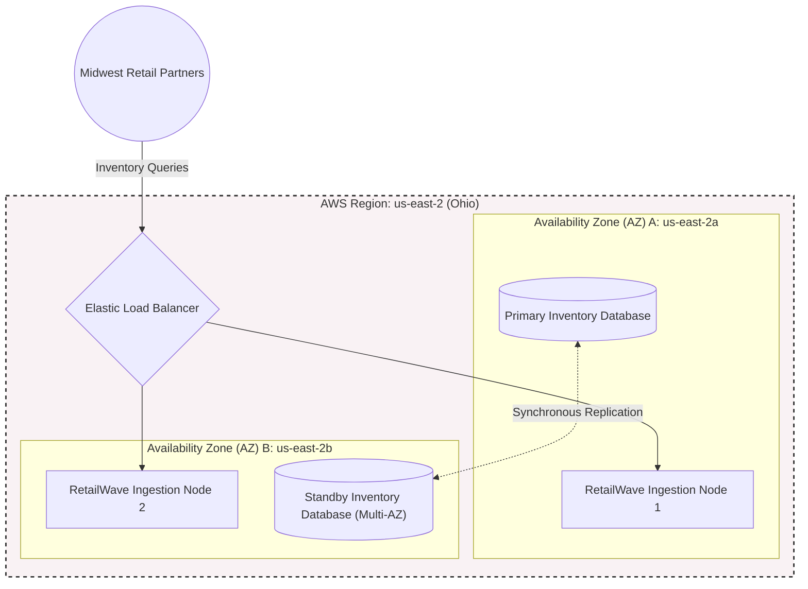
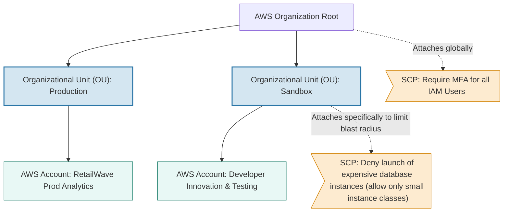

# Infrastructure and Governance Diagrams

**Client:** RetailWave Analytics
**Project:** Cloud Migration & Governance Foundation - Architectural Brief
**Author:** ApexCloud Solutions Consultancy Team

> This is a design-phase document. No live infrastructure is provisioned. Diagrams render in any Markdown viewer that supports Mermaid (GitHub, VS Code, GitLab); no AWS Management Console access is needed to review them.

---

## Part 1: High Availability Strategy (AWS Global Infrastructure)

**Context:** The 48-hour outage was caused by a localized power grid failure at the Chicago data center, where every system lived in one building. The new design places RetailWave in one **AWS Region** and splits the workload across two **Availability Zone (AZ)** nodes. Each AZ is one or more physically separate data centers with independent power, cooling and networking, so a localized failure takes out at most one AZ.



### Annotations

| Component | What it does | What happens if Availability Zone (AZ) A goes completely offline |
|---|---|---|
| **AWS Region: us-east-2 (Ohio)** | A geographic area containing multiple isolated AZs. Chosen for Midwest proximity (low latency for partners). | Region stays up; only one AZ is affected. |
| **Availability Zone (AZ) A / B** | Two independent data center groups with separate power and networking. | AZ B continues serving traffic. |
| **Elastic Load Balancer** | Single entry point for partner queries; health-checks both ingestion nodes and spans both AZs. | Stops sending traffic to Node 1 automatically; Node 2 serves all requests. |
| **Ingestion Nodes 1 and 2** | Identical application servers, one per AZ. | Node 2 carries the load (capacity should be sized so one node can handle peak traffic). |
| **Primary / Standby Inventory Database** | Primary writes data and synchronously replicates every change to the standby in the other AZ. | Standby is automatically promoted to primary (Multi-AZ failover); no manual action and no data loss. |

**Outcome:** The Chicago-style failure (one site loses power) becomes a non-event. Retail partners keep receiving inventory data while AWS restores the affected AZ.

> **Design note:** us-east-2 offers more than two AZs; two are the minimum required for this brief. A third can be added later for additional resilience.

---

## Part 2: Multi-Account Strategy (AWS Organizations)

**Context:** To address security concerns and bill shock, RetailWave will use AWS Organizations to separate work into distinct accounts grouped under **OUs** (Organizational Units). Experimental work is isolated from production data, and **SCPs** (Service Control Policies) set hard limits on what each account may do, regardless of what its own administrators grant.



### Annotations

| Element | Explanation |
|---|---|
| **AWS Organization Root** | Top of the hierarchy. Any SCP attached here applies to every account below it. |
| **Production OU** | Holds the account with live customer inventory data. It receives only the global SCP, so production is protected but not restricted from running the database sizes it needs. |
| **Sandbox OU** | Holds the Developer Innovation & Testing account. Experiments here cannot touch production data because the account is separate. |
| **SCP: Require MFA for all IAM Users** (attached at Root) | Applies to all accounts. Actions are denied unless the caller authenticated with **MFA**. |
| **SCP: Deny expensive database instances** (attached at the **Sandbox OU** only) | Prevents Sandbox users from provisioning costly database instance classes, even if a Sandbox administrator tries. This keeps experimental spend small and limits the blast radius of a mistake or compromised credentials. |

### Example SCP for the Sandbox OU (JSON policies document)

SCPs are written as JSON policies. This illustrative policy denies creating or restoring database instances unless they are small classes. The allowed list is an example for RetailWave to confirm.

```json
{
  "Version": "2012-10-17",
  "Statement": [
    {
      "Sid": "DenyExpensiveDatabaseInstancesInSandbox",
      "Effect": "Deny",
      "Action": [
        "rds:CreateDBInstance",
        "rds:RestoreDBInstanceFromDBSnapshot",
        "rds:ModifyDBInstance"
      ],
      "Resource": "*",
      "Condition": {
        "StringNotEquals": {
          "rds:DatabaseClass": ["db.t3.micro", "db.t4g.micro"]
        }
      }
    }
  ]
}
```

### Why attach at the Sandbox OU rather than the Root?

- Attaching at the **Root** would also restrict Production, which legitimately needs large Multi-AZ databases (see Part 1).
- Attaching to the **Sandbox OU** covers every current and future account placed there, so new experimental accounts inherit the cost guardrail automatically.

> **Note:** SCPs set the maximum permissions available; they do not grant access. IAM identity policies (see `security_and_iam_plan.md`) still decide what each user may do within those limits. SCPs do not apply to the management account, so it must not be used for workloads.
